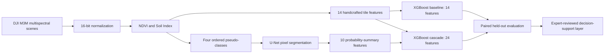
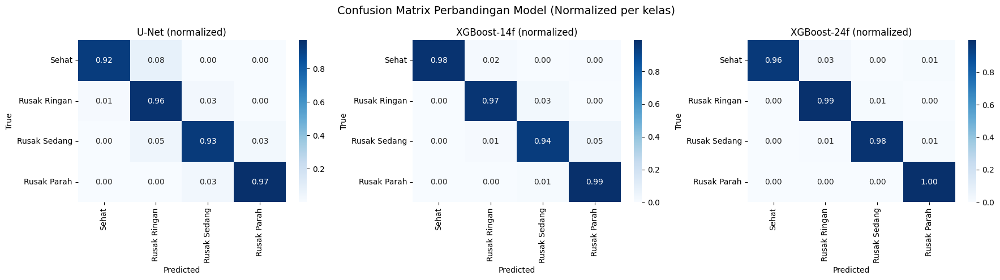

# NDVI-Soil Index UAV Land-Degradation Classification

[](https://www.python.org/)
[](LICENSE)
[](https://colab.research.google.com/github/haejoon06/ndvi-soil-index-uav-land-degradation/blob/main/notebooks/Penelitian_V2_clean.ipynb)

Research code, executed results, and manuscript for an expert-reviewed weak-supervision framework that combines multispectral UAV imagery, NDVI-Soil Index pseudo-labels, U-Net probability maps, and XGBoost tile classification.

The repository accompanies the manuscript:

> **An Expert-Reviewed NDVI-Soil Index Framework Using Multispectral UAV Imagery for Land Degradation Classification: Supporting Agripreneurship and Sustainable Agricultural Decision-Making**

The study uses 437 DJI M3M scenes acquired over agricultural land in Karawang, Indonesia, on 2 May 2026. Each scene contains RGB, green, red, red-edge, and near-infrared observations.

## Research question

Can probability summaries learned by a U-Net improve tile-level reproduction of ordered NDVI-Soil Index pseudo-classes when added to transparent spectral and texture features?

## Framework



The four operational spectral categories are **healthy**, **slight**, **moderate**, and **severe**. They are screening categories, not field diagnoses or universal agronomic thresholds.

## Main results

| Model | Evaluation unit | Accuracy | IoU | Dice / macro F1 |
|---|---:|---:|---:|---:|
| U-Net | Pixel | 0.9519 | 0.8560 | 0.9194 |
| XGBoost baseline, 14 features | Tile | 0.9777 | - | 0.9690 |
| XGBoost cascade, 24 features | Tile | 0.9929 | - | 0.9858 |

The cascade improved test macro F1 by **0.0169** and tile accuracy by **0.0152** over the baseline. On 17,556 paired test tiles, 332 predictions were corrected only by the cascade and 66 only by the baseline. McNemar, one-sided Wilcoxon, and one-sided paired t tests favored the cascade.

Pixel-level U-Net metrics and tile-level XGBoost metrics answer different questions and should not be interpreted as a direct architecture ranking.



Detailed tables are available in [`results/`](results/).

## Repository contents

```text
.
├── assets/                         # Selected figures extracted from the executed notebook
├── data/README.md                  # Required local data structure and availability notes
├── manuscript/manuscript.pdf      # Final manuscript with disclosures and AI acknowledgment
├── notebooks/
│   ├── Penelitian_V2_clean.ipynb  # Portable notebook without embedded outputs
│   └── Penelitian_V2_executed.ipynb # Original executed notebook with visual outputs
├── results/                        # Compact CSV summaries reproduced from notebook outputs
├── CITATION.cff
├── CONTRIBUTING.md
├── LICENSE
└── requirements.txt
```

The executed notebook is retained as an audit record and is approximately 27 MB. Use the clean notebook for GitHub rendering, review, and reruns.

## Reproducibility details

- **Scenes:** 437 complete five-file scenes (2,185 source files)
- **Scene split:** 305 train, 66 validation, 66 test (70:15:15; seed 42)
- **Tile size / stride:** 256 x 256 / 128
- **Tiles:** 81,130 train; 17,556 validation; 17,556 test
- **U-Net:** ResNet34 encoder, two input channels, four output classes, 10 epochs
- **XGBoost baseline:** 14 NDVI, Soil Index, histogram, and GLCM features
- **Cascade:** baseline features plus 10 U-Net probability summaries
- **Best validation U-Net checkpoint:** epoch 9, validation IoU 0.8642

The split is performed by scene before tile extraction to reduce leakage from overlapping tiles.

## Data preparation

The raw imagery is not committed to this repository because of file size and ownership/transfer restrictions. Arrange authorized data according to [`data/README.md`](data/README.md).

Set the workspace location before opening the notebook:

```bash
export LAND_DEGRADATION_DATA_DIR=/absolute/path/to/research-workspace
```

On Windows PowerShell:

```powershell
$env:LAND_DEGRADATION_DATA_DIR = "D:\path\to\research-workspace"
```

## Local setup

```bash
git clone https://github.com/haejoon06/ndvi-soil-index-uav-land-degradation.git
cd ndvi-soil-index-uav-land-degradation
python -m venv .venv
source .venv/bin/activate
python -m pip install --upgrade pip
pip install -r requirements.txt
jupyter lab notebooks/Penelitian_V2_clean.ipynb
```

For GPU training, install the PyTorch build appropriate for the local CUDA version before installing the remaining requirements. CPU execution is supported but full training and feature extraction are computationally expensive.

## Notebook execution order

Run the numbered sections in sequence:

1. Configure the environment and data paths.
2. Audit the source scenes and multispectral bands.
3. Compute vegetation indices.
4. Compute soil indices.
5. Generate rule-derived pseudo-label masks.
6. Split scenes and extract segmentation tiles.
7. Train and select the U-Net checkpoint.
8. Build baseline and cascade features and train XGBoost.
9. Generate visualizations and class-area summaries.
10. Evaluate the models and run paired statistical tests.
11. Export models and reports.

Generated models, tiles, masks, and large intermediate arrays are intentionally ignored by Git.

## Scientific interpretation and limitations

The target masks are generated from NDVI and Soil Index rules, while the models also use NDVI and Soil Index information. The reported performance therefore measures **agreement with rule-derived pseudo-labels**, not independent field accuracy, crop-health diagnosis, soil-quality measurement, or criterion validity against independently observed plots.

The framework is intended to prioritize scouting and expert review. Consequential decisions about treatment, input rates, yield, finance, insurance, or land value require agronomic context and independent field verification.

## Manuscript and citation

The current manuscript is available at [`manuscript/manuscript.pdf`](manuscript/manuscript.pdf). Citation metadata are provided in [`CITATION.cff`](CITATION.cff); GitHub can generate a formatted citation from the repository sidebar.

## Disclosures

The authors declare that there are no financial interests, commercial affiliations, or other potential conflicts of interest that could have influenced the objectivity of this research or the writing of this paper.

OpenAI Codex was used under author supervision for English-language editing, LaTeX formatting, provenance auditing, figure composition from verified outputs, and repository preparation. It did not generate flight observations, model predictions, or performance metrics. The authors remain responsible for all scientific claims and submitted files.

## License

Source code and notebook code are released under the [MIT License](LICENSE). The manuscript, source imagery, trained weights, and third-party materials are not relicensed by this repository.

